<!-- Archivo generado por prisma/erd/generator.ts. No editar a mano: se regenera con `prisma generate`. -->

# Diagrama de la base de datos

Fuente: `prisma/schema.prisma`. Versión navegable: [erd.html](./erd.html).

```mermaid
erDiagram
  User {
    String id PK
    String email UK "opcional"
    String passwordHash "opcional"
    String displayName
    String phone "opcional"
    UserRole role
    Boolean verified
    String googleSub UK "opcional · Identificador de la cuenta de Google del jugador."
    String appleSub UK "opcional · Identificador de la cuenta de Apple del jugador."
    String documentId UK "opcional · Cédula del jugador (sin puntos); con el celular sirve para iniciar sesión."
    DateTime birthDate "opcional"
    Sport favoriteSport "opcional"
    DateTime dataConsentAt "opcional · Aceptación de la política de tratamiento de datos (Ley 1581) y su versión."
    String dataConsentVersion "opcional"
    DateTime emailVerifiedAt "opcional · Previsto para verificar correo y celular con un código (aún no se usa)."
    DateTime phoneVerifiedAt "opcional"
    DateTime bannedAt "opcional · Cuándo el super admin bloqueó la cuenta; null = activa. Una cuenta bloqueada no puede
iniciar sesión ni usar la API (sus tokens dejan de valer)."
    String bannedReason "opcional · Motivo que escribió el super admin al bloquearla."
    String bannedById "opcional · Super admin que la bloqueó (sin llave foránea: el dato sobrevive si se borra esa cuenta)."
    DateTime createdAt
    DateTime updatedAt
  }
  Business {
    String id PK
    String ownerId FK, UK
    String name
    String address
    String neighborhood
    String description "opcional"
    Float latitude "opcional · Punto de llegada (WGS84). Ambos nulos si aún no se fijó en el mapa."
    Float longitude "opcional"
    String slug UK "opcional · Identificador del link público de reservas: /reservar/<slug>. Lo genera un
trigger de la base a partir del nombre al crear el negocio (nunca queda nulo)."
    Boolean onlineBookingEnabled "Si el link público acepta reservas de jugadores."
    DateTime createdAt
    DateTime updatedAt
  }
  BusinessProfileImage {
    String id PK
    String businessId FK, UK
    String storagePath "Ruta del archivo dentro del almacenamiento, p. ej. mi-cancha/business-profile/<negocio>/<id>.jpg"
    String contentType
    Int sizeBytes
    DateTime createdAt
    DateTime updatedAt
  }
  Court {
    String id PK
    String businessId FK
    String name
    Sport sport
    Boolean isCovered "true = cubierta o con techo; false = al aire libre."
    String currency "Código ISO 4217 de la moneda de los precios (COP, USD…)."
    Decimal basePricePerHour "Precio por hora cuando ninguna tarifa (CourtRate) cubre la franja."
    Int slotDuration "Duración de cada turno en minutos: 30, 60, 90 o 120."
    String surfaceId FK "opcional · Superficie o tipo de grama (catálogo); null si no se indicó."
    Decimal lengthMeters "opcional · Medidas en metros. Van las dos o ninguna."
    Decimal widthMeters "opcional"
    Int playersPerSide "opcional · Formato: jugadores por equipo (5 en fútbol 5, 2 en pádel); null si no se indicó."
    Boolean isActive
    DateTime createdAt
    DateTime updatedAt
  }
  SlotHold {
    String id PK
    String businessId FK
    String courtId FK
    String playerId FK
    DateTime start "Inicio del primer turno y fin del último."
    DateTime end
    Int slots
    DateTime expiresAt
    DateTime createdAt
    DateTime updatedAt
  }
  CourtSchedule {
    String id PK
    String courtId FK
    DayOfWeek dayOfWeek
    Boolean isOpen
    String openTime "opcional · Hora local HH:mm; null si está cerrado."
    String closeTime "opcional · Hora local HH:mm; null si está cerrado."
  }
  CourtRate {
    String id PK
    String courtId FK
    String name
    Decimal pricePerHour
    DayOfWeek[] days "Días en los que empieza la franja."
    String startTime "Hora local HH:mm. Si endTime es menor, la franja termina al día siguiente."
    String endTime
    Int sortOrder
  }
  CourtPhoto {
    String id PK
    String courtId FK
    CourtPhotoSlot slot
    String storagePath "Ruta del archivo en el almacenamiento, p. ej. mi-cancha/courts/<cancha>/<id>.jpg"
    String contentType
    Int sizeBytes
    DateTime createdAt
  }
  Reservation {
    String id PK
    String businessId FK
    String courtId FK
    String playerId FK "opcional"
    String customerId FK "opcional · Cliente del negocio; null en reservas anteriores a la tabla de clientes."
    DateTime start
    DateTime end
    String customerName "Nombre y teléfono del cliente al momento de reservar."
    String customerDetail "opcional"
    String phone
    String contactNote "opcional"
    String tag "opcional"
    Boolean isRecurring
    ReservationSource source "BUSINESS si la creó el negocio o el super admin; WEB si la creó el jugador."
    Decimal subtotal "Valor según las tarifas, antes del descuento."
    Decimal discount
    Decimal totalPrice "subtotal - discount, en la moneda de la cancha."
    ReservationStatus status
    String groupId FK "opcional · Reserva de varias canchas a la vez: las del mismo grupo comparten franja,
se pagan y se cancelan juntas. null = reserva de una sola cancha."
    String cancellationReason "opcional"
    DateTime cancelledAt "opcional"
    String cancelledById FK "opcional"
    DateTime createdAt
    DateTime updatedAt
  }
  ReservationGroup {
    String id PK
    String businessId FK
    DateTime createdAt
  }
  Customer {
    String id PK
    String businessId FK
    String name
    String phone
    String documentId "opcional · Número de cédula u otro documento de identidad. null solo en clientes que
llegaron por la web y aún no la registran (el negocio siempre la pide)."
    Sport preferredSport "opcional · Deporte habitual elegido por el negocio; si es null se usa el más reservado."
    String notes "opcional · Notas internas del negocio (no las ve el cliente)."
    String userId FK "opcional · Cuenta de jugador vinculada (si se registró en la web)."
    DateTime createdAt
    DateTime updatedAt
  }
  Refund {
    String id PK
    String businessId FK
    String reservationId FK
    String paymentId FK, UK
    String customerId FK "opcional"
    Decimal amount
    String reason "Motivo de la cancelación que originó la devolución."
    String createdById FK "opcional"
    DateTime createdAt
  }
  Payment {
    String id PK
    String businessId FK
    String reservationId FK "opcional"
    String customerName
    Decimal amount "Monto en la moneda del negocio, con hasta 2 decimales."
    String methodId FK
    PaymentConcept concept
    PaymentStatus status
    String reference "opcional"
    String note "opcional"
    String rejectionReason "opcional"
    Boolean registeredByBusiness
    DateTime receivedAt
    DateTime updatedAt
  }
  Amenity {
    String id PK
    String code UK "Código estable que usan la API y la app (p. ej. PARQUEADERO)."
    String name
    Boolean active
    Int sortOrder
    DateTime createdAt
    DateTime updatedAt
  }
  CourtSurface {
    String id PK
    String code UK "Código estable que usan la API y la app (p. ej. GRAMA_SINTETICA)."
    String name
    Sport[] sports "Deportes en los que se ofrece; vacío = todos."
    Boolean active
    Int sortOrder
    DateTime createdAt
    DateTime updatedAt
  }
  PaymentMethod {
    String id PK
    String code UK "Código estable que usan la API y la app (p. ej. NEQUI)."
    String name
    Boolean requiresReference "Si al registrar el pago se pide número de referencia o comprobante (opcional)."
    Boolean active
    Int sortOrder
    DateTime createdAt
    DateTime updatedAt
  }
  Plan {
    String id PK
    String name UK
    Int monthlyPrice "Precio mensual en COP."
    Int courtLimit
    Json benefits "Lista de { title, detail }."
  }
  Subscription {
    String id PK
    String businessId FK, UK
    String planId FK
    DateTime since
    DateTime nextPayment
    Boolean isActive
    Boolean autoBilling
  }
  OtpCode {
    String id PK
    String phone "Celular en formato E.164 (+573001234567)."
    String codeHash
    String ipHash "opcional · HMAC de la IP que lo pidió: limita solicitudes por IP sin guardarla."
    DateTime expiresAt
    Int attempts
    DateTime usedAt "opcional · Cuándo se usó; un código usado no se acepta otra vez."
    DateTime createdAt
  }
  AuditLog {
    String id PK
    AuditCategory category
    String action "Código estable del evento, p. ej. client.created o player.login_failed."
    Boolean success "false en intentos rechazados (ingreso fallido, límite de códigos)."
    String actorId "opcional · Cuenta que lo hizo; null si no había sesión (p. ej. un ingreso fallido)."
    UserRole actorRole "opcional"
    String actorLabel "opcional · Nombre, correo o celular de quien lo hizo, como se veía en ese momento."
    String entityType "opcional · Sobre qué actuó: tipo (Business, User, Plan…) e id."
    String entityId "opcional"
    Json metadata "opcional · Detalle del evento (ruta, cambios, motivo). Nunca contraseñas, códigos ni tokens."
    String ipHash "opcional · HMAC de la IP (la misma de los códigos SMS); la IP real no se guarda."
    DateTime createdAt
  }
  User ||--o| Business : "business"
  Business ||--o| BusinessProfileImage : "profileImage"
  Business ||--o{ Court : "courts"
  CourtSurface |o--o{ Court : "courts"
  Business ||--o{ SlotHold : "slotHolds"
  Court ||--o{ SlotHold : "slotHolds"
  User ||--o{ SlotHold : "slotHolds"
  Court ||--o{ CourtSchedule : "schedules"
  Court ||--o{ CourtRate : "rates"
  Court ||--o{ CourtPhoto : "photos"
  Business ||--o{ Reservation : "reservations"
  Court ||--o{ Reservation : "reservations"
  User |o--o{ Reservation : "reservations"
  Customer |o--o{ Reservation : "reservations"
  ReservationGroup |o--o{ Reservation : "reservations"
  User |o--o{ Reservation : "cancelledReservations"
  Business ||--o{ ReservationGroup : "reservationGroups"
  Business ||--o{ Customer : "customers"
  User |o--o{ Customer : "customers"
  Business ||--o{ Refund : "refunds"
  Reservation ||--o{ Refund : "refunds"
  Payment ||--o| Refund : "refund"
  Customer |o--o{ Refund : "refunds"
  User |o--o{ Refund : "refunds"
  Business ||--o{ Payment : "payments"
  Reservation |o--o{ Payment : "payments"
  PaymentMethod ||--o{ Payment : "payments"
  Amenity }o--o{ Business : "AmenityToBusiness"
  Business ||--o| Subscription : "subscription"
  Plan ||--o{ Subscription : "subscriptions"
```

**Leyenda:** PK llave primaria · FK llave foránea · UK única · `||` exactamente uno · `|o` cero o uno · `o{` cero o muchos · `}o--o{` muchos a muchos.

## Tablas

### User

Cualquier persona que inicia sesión: super admin, administrador de negocio o jugador (según role).
Los negocios entran con email y contraseña; los jugadores con Google o Apple.

- **Business**: Puede tener un Business (campo business); la llave foránea está en Business.
- **Customer**: Tiene cero o muchos Customer (campo customers). Cada Customer apunta a este User.
- **Reservation**: Tiene cero o muchos Reservation (campo reservations). Cada Reservation apunta a este User.
- **Reservation**: Tiene cero o muchos Reservation (campo cancelledReservations). Cada Reservation apunta a este User.
- **Refund**: Tiene cero o muchos Refund (campo refunds). Cada Refund apunta a este User.
- **SlotHold**: Tiene cero o muchos SlotHold (campo slotHolds). Cada SlotHold apunta a este User.

### Business

La sede deportiva de un cliente. Cada administrador de negocio tiene exactamente una.

- **User**: Pertenece siempre a un User mediante ownerId; un User tiene como máximo un Business. Si se borra el User, se borra también su Business.
- **Amenity**: Muchos a muchos con Amenity: cada Business puede tener varios Amenity y cada Amenity puede estar en varios Business (campo amenities).
- **Court**: Tiene cero o muchos Court (campo courts). Cada Court apunta a este Business.
- **Customer**: Tiene cero o muchos Customer (campo customers). Cada Customer apunta a este Business.
- **Reservation**: Tiene cero o muchos Reservation (campo reservations). Cada Reservation apunta a este Business.
- **Payment**: Tiene cero o muchos Payment (campo payments). Cada Payment apunta a este Business.
- **Refund**: Tiene cero o muchos Refund (campo refunds). Cada Refund apunta a este Business.
- **Subscription**: Puede tener un Subscription (campo subscription); la llave foránea está en Subscription.
- **BusinessProfileImage**: Puede tener un BusinessProfileImage (campo profileImage); la llave foránea está en BusinessProfileImage.
- **SlotHold**: Tiene cero o muchos SlotHold (campo slotHolds). Cada SlotHold apunta a este Business.
- **ReservationGroup**: Tiene cero o muchos ReservationGroup (campo reservationGroups). Cada ReservationGroup apunta a este Business.

### BusinessProfileImage

Foto de portada del negocio. Una por negocio; el archivo vive en Koofr.

- **Business**: Pertenece siempre a un Business mediante businessId; un Business tiene como máximo un BusinessProfileImage. Si se borra el Business, se borra también su BusinessProfileImage.

### Court

Cancha que el negocio alquila por turnos. Solo recibe reservas si está activa (isActive) y
completa (tiene las fotos MAIN, SURFACE y LIGHTING). El límite del plan cuenta las activas.

- **Business**: Pertenece siempre a un Business mediante businessId; un Business puede tener varios Court. Si se borra el Business, se borran también sus Court.
- **CourtSurface**: Puede pertenecer a un CourtSurface mediante surfaceId; un CourtSurface puede tener varios Court. Si se borra el CourtSurface, el Court se conserva sin CourtSurface.
- **CourtSchedule**: Tiene cero o muchos CourtSchedule (campo schedules). Cada CourtSchedule apunta a este Court.
- **CourtRate**: Tiene cero o muchos CourtRate (campo rates). Cada CourtRate apunta a este Court.
- **CourtPhoto**: Tiene cero o muchos CourtPhoto (campo photos). Cada CourtPhoto apunta a este Court.
- **Reservation**: Tiene cero o muchos Reservation (campo reservations). Cada Reservation apunta a este Court.
- **SlotHold**: Tiene cero o muchos SlotHold (campo slotHolds). Cada SlotHold apunta a este Court.

### SlotHold

Turnos que un jugador apartó en la web mientras confirma la reserva. Vencen
solos (expiresAt). Un jugador tiene un solo apartado por negocio, de 1 a 3
canchas (una fila por cancha, todas con la misma franja).

- **Business**: Pertenece siempre a un Business mediante businessId; un Business puede tener varios SlotHold. Si se borra el Business, se borran también sus SlotHold.
- **Court**: Pertenece siempre a un Court mediante courtId; un Court puede tener varios SlotHold. Si se borra el Court, se borran también sus SlotHold.
- **User**: Pertenece siempre a un User mediante playerId; un User puede tener varios SlotHold. Si se borra el User, se borran también sus SlotHold.

### CourtSchedule

Horario de una cancha para un día de la semana. Siempre hay 7 por cancha.
Si closeTime es menor que openTime, la cancha cierra al día siguiente (p. ej. 18:00 a 02:00).

- **Court**: Pertenece siempre a un Court mediante courtId; un Court puede tener varios CourtSchedule. Si se borra el Court, se borran también sus CourtSchedule.

### CourtRate

Tarifa de una franja horaria (p. ej. nocturna). Reemplaza al precio base en esa franja;
una reserva que cruza franjas se cobra por fracciones. Las tarifas no se pueden cruzar.

- **Court**: Pertenece siempre a un Court mediante courtId; un Court puede tener varios CourtRate. Si se borra el Court, se borran también sus CourtRate.

### CourtPhoto

Foto de una cancha en una posición fija. El archivo vive en Koofr.

- **Court**: Pertenece siempre a un Court mediante courtId; un Court puede tener varios CourtPhoto. Si se borra el Court, se borran también sus CourtPhoto.

### Reservation

Un turno reservado en una cancha. La crea el negocio desde la app (o un jugador, en el futuro).

- **Business**: Pertenece siempre a un Business mediante businessId; un Business puede tener varios Reservation. Si se borra el Business, se borran también sus Reservation.
- **Court**: Pertenece siempre a un Court mediante courtId; un Court puede tener varios Reservation. No se puede borrar un Court mientras tenga Reservation.
- **User**: Puede pertenecer a un User mediante playerId; un User puede tener varios Reservation. Si se borra el User, el Reservation se conserva sin User.
- **Customer**: Puede pertenecer a un Customer mediante customerId; un Customer puede tener varios Reservation. Si se borra el Customer, el Reservation se conserva sin Customer.
- **ReservationGroup**: Puede pertenecer a un ReservationGroup mediante groupId; un ReservationGroup puede tener varios Reservation. Si se borra el ReservationGroup, el Reservation se conserva sin ReservationGroup.
- **User**: Puede pertenecer a un User mediante cancelledById; un User puede tener varios Reservation. Si se borra el User, el Reservation se conserva sin User.
- **Payment**: Tiene cero o muchos Payment (campo payments). Cada Payment apunta a este Reservation.
- **Refund**: Tiene cero o muchos Refund (campo refunds). Cada Refund apunta a este Reservation.

### ReservationGroup

Varias canchas (máximo 3) reservadas a la vez en la misma franja. Cada cancha
es una Reservation con este grupo; los pagos van en la primera reserva.

- **Business**: Pertenece siempre a un Business mediante businessId; un Business puede tener varios ReservationGroup. Si se borra el Business, se borran también sus ReservationGroup.
- **Reservation**: Tiene cero o muchos Reservation (campo reservations). Cada Reservation apunta a este ReservationGroup.

### Customer

Dinero recibido por el negocio, normalmente ligado a una reserva. Los pagos por transferencia
Cliente de un negocio (quien reserva). Cada negocio tiene su propia lista;
teléfono y cédula son únicos dentro del negocio. El nivel de fidelidad no se
guarda: se calcula con sus reservas.

- **Business**: Pertenece siempre a un Business mediante businessId; un Business puede tener varios Customer. Si se borra el Business, se borran también sus Customer.
- **User**: Puede pertenecer a un User mediante userId; un User puede tener varios Customer. Si se borra el User, el Customer se conserva sin User.
- **Reservation**: Tiene cero o muchos Reservation (campo reservations). Cada Reservation apunta a este Customer.
- **Refund**: Tiene cero o muchos Refund (campo refunds). Cada Refund apunta a este Customer.

### Refund

Devolución de un pago aprobado al cancelar su reserva. El pago queda REFUNDED.

- **Business**: Pertenece siempre a un Business mediante businessId; un Business puede tener varios Refund. Si se borra el Business, se borran también sus Refund.
- **Reservation**: Pertenece siempre a un Reservation mediante reservationId; un Reservation puede tener varios Refund. Si se borra el Reservation, se borran también sus Refund.
- **Payment**: Pertenece siempre a un Payment mediante paymentId; un Payment tiene como máximo un Refund. Si se borra el Payment, se borra también su Refund.
- **Customer**: Puede pertenecer a un Customer mediante customerId; un Customer puede tener varios Refund. Si se borra el Customer, el Refund se conserva sin Customer.
- **User**: Puede pertenecer a un User mediante createdById; un User puede tener varios Refund. Si se borra el User, el Refund se conserva sin User.

### Payment

quedan pendientes hasta que el negocio los aprueba o rechaza.

- **Business**: Pertenece siempre a un Business mediante businessId; un Business puede tener varios Payment. Si se borra el Business, se borran también sus Payment.
- **Reservation**: Puede pertenecer a un Reservation mediante reservationId; un Reservation puede tener varios Payment. Si se borra el Reservation, el Payment se conserva sin Reservation.
- **PaymentMethod**: Pertenece siempre a un PaymentMethod mediante methodId; un PaymentMethod puede tener varios Payment. No se puede borrar un PaymentMethod mientras tenga Payment.
- **Refund**: Puede tener un Refund (campo refund); la llave foránea está en Refund.

### Amenity

Catálogo editable desde el panel: servicios que ofrece un negocio.

- **Business**: Muchos a muchos con Business: cada Amenity puede tener varios Business y cada Business puede estar en varios Amenity (campo businesses).

### CourtSurface

Catálogo editable desde el panel: superficie o tipo de grama de una cancha.

- **Court**: Tiene cero o muchos Court (campo courts). Cada Court apunta a este CourtSurface.

### PaymentMethod

Catálogo editable desde el panel: medios con los que se recibe un pago.

- **Payment**: Tiene cero o muchos Payment (campo payments). Cada Payment apunta a este PaymentMethod.

### Plan

Plan de suscripción de Mi Cancha (Gratis, Básico, Pro): precio mensual y cuántas canchas permite.

- **Subscription**: Tiene cero o muchos Subscription (campo subscriptions). Cada Subscription apunta a este Plan.

### Subscription

Plan que tiene contratado un negocio, su estado (activo o suspendido) y la fecha del próximo cobro.

- **Business**: Pertenece siempre a un Business mediante businessId; un Business tiene como máximo un Subscription. Si se borra el Business, se borra también su Subscription.
- **Plan**: Pertenece siempre a un Plan mediante planId; un Plan puede tener varios Subscription. No se puede borrar un Plan mientras tenga Subscription.

### OtpCode

Códigos de un solo uso (OTP) enviados por SMS para verificar un celular. Se
guarda solo su HMAC-SHA256, nunca el código; vencen a los 5 minutos y se
invalidan tras 5 intentos fallidos.

### AuditLog

Auditoría: quién hizo qué y cuándo. La app solo agrega filas; nunca las edita ni las borra.
Sin llave foránea al usuario a propósito: el registro debe sobrevivir si se borra la cuenta.

## Enums

| Enum | Valores |
|---|---|
| `UserRole` | `SUPER_ADMIN`, `ADMIN_NEGOCIO`, `JUGADOR` |
| `Sport` | `FUTBOL`, `PADEL`, `BALONCESTO`, `VOLEIBOL` |
| `DayOfWeek` | `MONDAY`, `TUESDAY`, `WEDNESDAY`, `THURSDAY`, `FRIDAY`, `SATURDAY`, `SUNDAY` |
| `CourtPhotoSlot` | `MAIN`, `SURFACE`, `LIGHTING`, `EXTRA_1`, `EXTRA_2` |
| `ReservationSource` | `BUSINESS`, `WEB` |
| `ReservationStatus` | `CONFIRMED`, `COMPLETED`, `NO_SHOW`, `CANCELLED` |
| `PaymentConcept` | `ANTICIPO`, `SALDO`, `TOTAL` |
| `PaymentStatus` | `PENDING`, `APPROVED`, `REJECTED`, `REFUNDED` |
| `AuditCategory` | `ADMIN`, `SECURITY` |

## Únicos compuestos

- User: (role, phone)
- Court: (businessId, name)
- SlotHold: (businessId, playerId, courtId)
- CourtSchedule: (courtId, dayOfWeek)
- CourtPhoto: (courtId, slot)
- Customer: (businessId, phone)
- Customer: (businessId, documentId)
- Customer: (businessId, userId)
