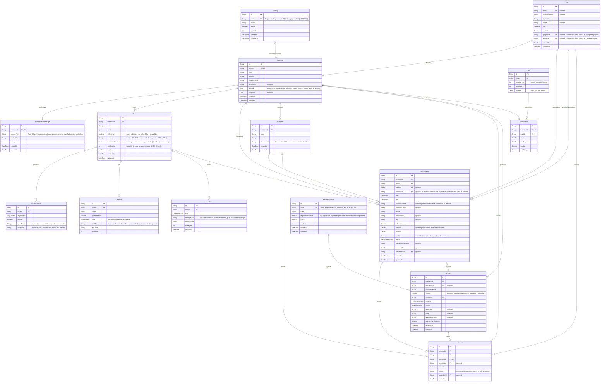

<!-- Archivo generado por prisma/erd/generator.ts. No editar a mano: se regenera con `prisma generate`. -->

# Diagrama de la base de datos

Fuente: `prisma/schema.prisma`. Versión navegable: [erd.html](./erd.html).

**Leyenda:** PK llave primaria · FK llave foránea · UK única · `||` exactamente uno · `|o` cero o uno · `o{` cero o muchos · `}o--o{` muchos a muchos.

## Tablas

### User

Cualquier persona que inicia sesión: super admin, administrador de negocio o jugador (según role).
Los negocios entran con email y contraseña; los jugadores con Google o Apple.

- **Business**: Puede tener un Business (campo business); la llave foránea está en Business.
- **Reservation**: Tiene cero o muchos Reservation (campo reservations). Cada Reservation apunta a este User.
- **Reservation**: Tiene cero o muchos Reservation (campo cancelledReservations). Cada Reservation apunta a este User.
- **Refund**: Tiene cero o muchos Refund (campo refunds). Cada Refund apunta a este User.

### Business

La sede deportiva de un cliente. Cada administrador de negocio tiene exactamente una.

- **User**: Pertenece siempre a un User mediante ownerId; un User tiene como máximo un Business. Si se borra el User, se borra también su Business.
- **Amenity**: Muchos a muchos con Amenity: cada Business puede tener varios Amenity y cada Amenity puede estar en varios Business (campo amenities).
- **Court**: Tiene cero o muchos Court (campo courts). Cada Court apunta a este Business.
- **Customer**: Tiene cero o muchos Customer (campo customers). Cada Customer apunta a este Business.
- **Reservation**: Tiene cero o muchos Reservation (campo reservations). Cada Reservation apunta a este Business.
- **Payment**: Tiene cero o muchos Payment (campo payments). Cada Payment apunta a este Business.
- **Refund**: Tiene cero o muchos Refund (campo refunds). Cada Refund apunta a este Business.
- **Subscription**: Puede tener un Subscription (campo subscription); la llave foránea está en Subscription.
- **BusinessProfileImage**: Puede tener un BusinessProfileImage (campo profileImage); la llave foránea está en BusinessProfileImage.

### BusinessProfileImage

Foto de portada del negocio. Una por negocio; el archivo vive en Koofr.

- **Business**: Pertenece siempre a un Business mediante businessId; un Business tiene como máximo un BusinessProfileImage. Si se borra el Business, se borra también su BusinessProfileImage.

### Court

Cancha que el negocio alquila por turnos. Solo recibe reservas si está activa (isActive) y
completa (tiene las fotos MAIN, SURFACE y LIGHTING). El límite del plan cuenta las activas.

- **Business**: Pertenece siempre a un Business mediante businessId; un Business puede tener varios Court. Si se borra el Business, se borran también sus Court.
- **CourtSchedule**: Tiene cero o muchos CourtSchedule (campo schedules). Cada CourtSchedule apunta a este Court.
- **CourtRate**: Tiene cero o muchos CourtRate (campo rates). Cada CourtRate apunta a este Court.
- **CourtPhoto**: Tiene cero o muchos CourtPhoto (campo photos). Cada CourtPhoto apunta a este Court.
- **Reservation**: Tiene cero o muchos Reservation (campo reservations). Cada Reservation apunta a este Court.

### CourtSchedule

Horario de una cancha para un día de la semana. Siempre hay 7 por cancha.
Si closeTime es menor que openTime, la cancha cierra al día siguiente (p. ej. 18:00 a 02:00).

- **Court**: Pertenece siempre a un Court mediante courtId; un Court puede tener varios CourtSchedule. Si se borra el Court, se borran también sus CourtSchedule.

### CourtRate

Tarifa de una franja horaria (p. ej. nocturna). Reemplaza al precio base en esa franja;
una reserva que cruza franjas se cobra por fracciones. Las tarifas no se pueden cruzar.

- **Court**: Pertenece siempre a un Court mediante courtId; un Court puede tener varios CourtRate. Si se borra el Court, se borran también sus CourtRate.

### CourtPhoto

Foto de una cancha en una posición fija. El archivo vive en Koofr.

- **Court**: Pertenece siempre a un Court mediante courtId; un Court puede tener varios CourtPhoto. Si se borra el Court, se borran también sus CourtPhoto.

### Reservation

Un turno reservado en una cancha. La crea el negocio desde la app (o un jugador, en el futuro).

- **Business**: Pertenece siempre a un Business mediante businessId; un Business puede tener varios Reservation. Si se borra el Business, se borran también sus Reservation.
- **Court**: Pertenece siempre a un Court mediante courtId; un Court puede tener varios Reservation. No se puede borrar un Court mientras tenga Reservation.
- **User**: Puede pertenecer a un User mediante playerId; un User puede tener varios Reservation. Si se borra el User, el Reservation se conserva sin User.
- **Customer**: Puede pertenecer a un Customer mediante customerId; un Customer puede tener varios Reservation. Si se borra el Customer, el Reservation se conserva sin Customer.
- **User**: Puede pertenecer a un User mediante cancelledById; un User puede tener varios Reservation. Si se borra el User, el Reservation se conserva sin User.
- **Payment**: Tiene cero o muchos Payment (campo payments). Cada Payment apunta a este Reservation.
- **Refund**: Tiene cero o muchos Refund (campo refunds). Cada Refund apunta a este Reservation.

### Customer

Dinero recibido por el negocio, normalmente ligado a una reserva. Los pagos por transferencia
Cliente de un negocio (quien reserva). Cada negocio tiene su propia lista;
teléfono y cédula son únicos dentro del negocio.

- **Business**: Pertenece siempre a un Business mediante businessId; un Business puede tener varios Customer. Si se borra el Business, se borran también sus Customer.
- **Reservation**: Tiene cero o muchos Reservation (campo reservations). Cada Reservation apunta a este Customer.
- **Refund**: Tiene cero o muchos Refund (campo refunds). Cada Refund apunta a este Customer.

### Refund

Devolución de un pago aprobado al cancelar su reserva. El pago queda REFUNDED.

- **Business**: Pertenece siempre a un Business mediante businessId; un Business puede tener varios Refund. Si se borra el Business, se borran también sus Refund.
- **Reservation**: Pertenece siempre a un Reservation mediante reservationId; un Reservation puede tener varios Refund. Si se borra el Reservation, se borran también sus Refund.
- **Payment**: Pertenece siempre a un Payment mediante paymentId; un Payment tiene como máximo un Refund. Si se borra el Payment, se borra también su Refund.
- **Customer**: Puede pertenecer a un Customer mediante customerId; un Customer puede tener varios Refund. Si se borra el Customer, el Refund se conserva sin Customer.
- **User**: Puede pertenecer a un User mediante createdById; un User puede tener varios Refund. Si se borra el User, el Refund se conserva sin User.

### Payment

quedan pendientes hasta que el negocio los aprueba o rechaza.

- **Business**: Pertenece siempre a un Business mediante businessId; un Business puede tener varios Payment. Si se borra el Business, se borran también sus Payment.
- **Reservation**: Puede pertenecer a un Reservation mediante reservationId; un Reservation puede tener varios Payment. Si se borra el Reservation, el Payment se conserva sin Reservation.
- **PaymentMethod**: Pertenece siempre a un PaymentMethod mediante methodId; un PaymentMethod puede tener varios Payment. No se puede borrar un PaymentMethod mientras tenga Payment.
- **Refund**: Puede tener un Refund (campo refund); la llave foránea está en Refund.

### Amenity

Catálogo editable desde el panel: servicios que ofrece un negocio.

- **Business**: Muchos a muchos con Business: cada Amenity puede tener varios Business y cada Business puede estar en varios Amenity (campo businesses).

### PaymentMethod

Catálogo editable desde el panel: medios con los que se recibe un pago.

- **Payment**: Tiene cero o muchos Payment (campo payments). Cada Payment apunta a este PaymentMethod.

### Plan

Plan de suscripción de Mi Cancha (Gratis, Básico, Pro): precio mensual y cuántas canchas permite.

- **Subscription**: Tiene cero o muchos Subscription (campo subscriptions). Cada Subscription apunta a este Plan.

### Subscription

Plan que tiene contratado un negocio, su estado (activo o suspendido) y la fecha del próximo cobro.

- **Business**: Pertenece siempre a un Business mediante businessId; un Business tiene como máximo un Subscription. Si se borra el Business, se borra también su Subscription.
- **Plan**: Pertenece siempre a un Plan mediante planId; un Plan puede tener varios Subscription. No se puede borrar un Plan mientras tenga Subscription.

## Enums

| Enum | Valores |
|---|---|
| `UserRole` | `SUPER_ADMIN`, `ADMIN_NEGOCIO`, `JUGADOR` |
| `Sport` | `FUTBOL`, `PADEL`, `BALONCESTO`, `VOLEIBOL` |
| `DayOfWeek` | `MONDAY`, `TUESDAY`, `WEDNESDAY`, `THURSDAY`, `FRIDAY`, `SATURDAY`, `SUNDAY` |
| `CourtPhotoSlot` | `MAIN`, `SURFACE`, `LIGHTING`, `EXTRA_1`, `EXTRA_2` |
| `ReservationStatus` | `CONFIRMED`, `COMPLETED`, `NO_SHOW`, `CANCELLED` |
| `PaymentConcept` | `ANTICIPO`, `SALDO`, `TOTAL` |
| `PaymentStatus` | `PENDING`, `APPROVED`, `REJECTED`, `REFUNDED` |

## Únicos compuestos

- Court: (businessId, name)
- CourtSchedule: (courtId, dayOfWeek)
- CourtPhoto: (courtId, slot)
- Customer: (businessId, phone)
- Customer: (businessId, documentId)
