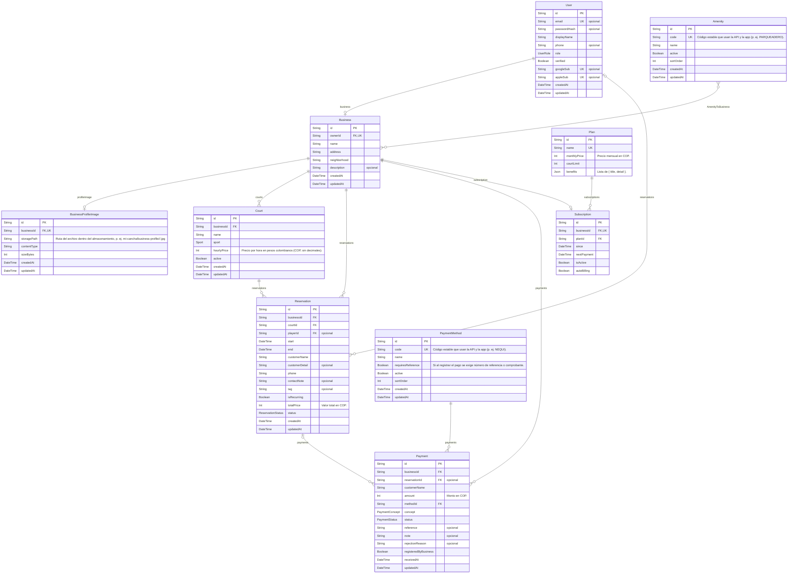

<!-- Archivo generado por prisma/erd/generator.ts. No editar a mano: se regenera con `prisma generate`. -->

# Diagrama de la base de datos

Fuente: `prisma/schema.prisma`. Versión navegable: [erd.html](./erd.html).

**Leyenda:** PK llave primaria · FK llave foránea · UK única · `||` exactamente uno · `|o` cero o uno · `o{` cero o muchos · `}o--o{` muchos a muchos.

## Enums

| Enum | Valores |
|---|---|
| `UserRole` | `SUPER_ADMIN`, `ADMIN_NEGOCIO`, `JUGADOR` |
| `Sport` | `FUTBOL`, `PADEL`, `BALONCESTO`, `VOLEIBOL` |
| `ReservationStatus` | `CONFIRMED`, `COMPLETED`, `NO_SHOW`, `CANCELLED` |
| `PaymentConcept` | `ANTICIPO`, `SALDO`, `TOTAL` |
| `PaymentStatus` | `PENDING`, `APPROVED`, `REJECTED` |

## Únicos compuestos

- Court: (businessId, name)
